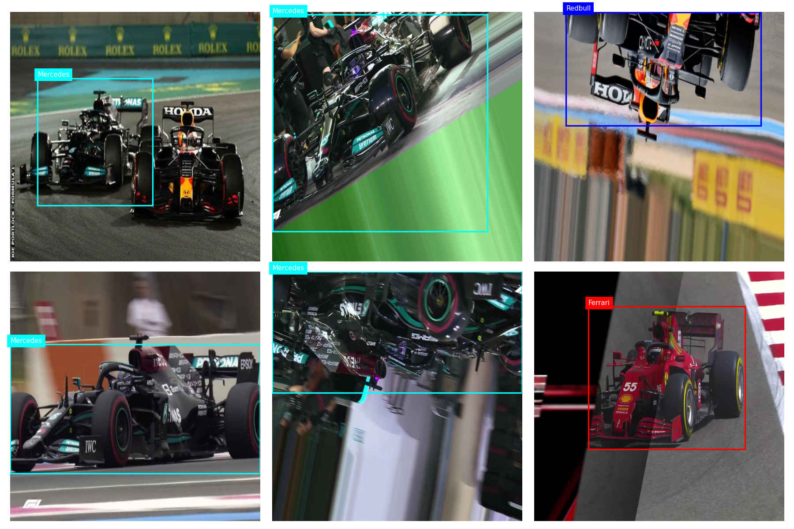
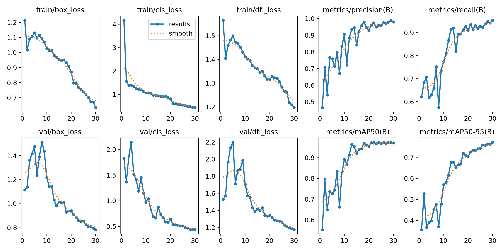
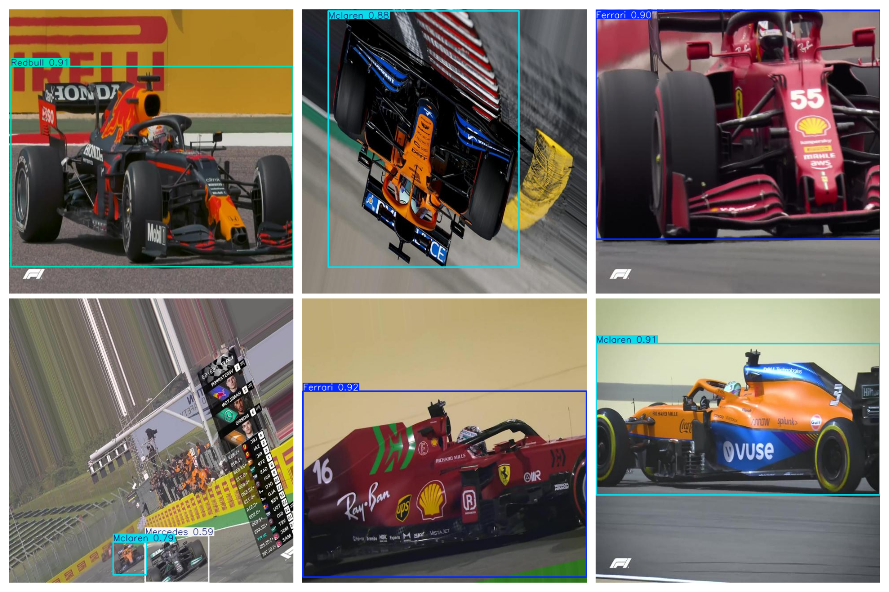
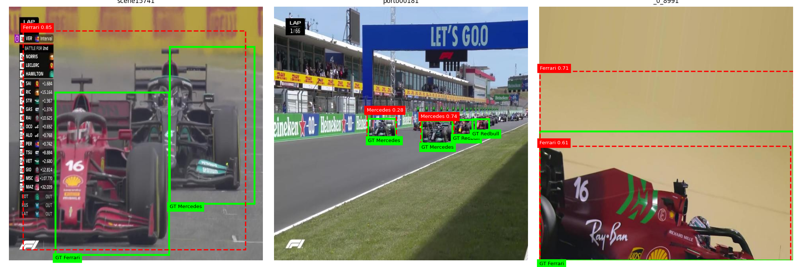

# Formula 1 Team Car Detector - CSCI1409 Bonus Project

Author: Kramarov Maxim, KBTU, CSCI1409 Deep Learning, Fall 2026.

## Task

This repository trains an object detector that finds Formula 1 cars in photos and labels the team of each car. There are 4 classes: Ferrari, Mclaren, Mercedes and Redbull. We fine-tune a small pretrained YOLOv8n model with the Ultralytics framework, run one controlled experiment, evaluate the final model once on a held-out test set and analyse its failures. Everything runs in Google Colab on a free T4 GPU.

## Quick start

1. Click the Open in Colab badge above.
2. Select Runtime - Change runtime type - T4 GPU.
3. Select Runtime - Run all. The notebook installs the pinned Ultralytics version, downloads the prepared dataset from the GitHub release, trains both runs, evaluates them and shows predictions.
4. The notebook asks to connect Google Drive. Drive is only used to save results, so they are not lost if the Colab session resets.

To only run predictions with the final model, use the last notebook cell. It downloads the final checkpoint and predicts on a test image.

Downloads, both from release v1.0 of this repository:

- Prepared dataset: https://github.com/MiH0per/DeepLearning/releases/download/v1.0/f1_subset.zip
- Final trained checkpoint: https://github.com/MiH0per/DeepLearning/releases/download/v1.0/best.pt

## Dataset

Source: detection f1 cars, version 12, by Tarik Yilmaz kanzileri, published on Roboflow Universe:
https://universe.roboflow.com/tarik-yilmaz/detection-f1-cars/dataset/12

License: CC BY 4.0. The dataset may be shared and adapted with attribution. Our prepared subset is redistributed in the release under the same license with this attribution.

Classes: 0 Ferrari, 1 Mclaren, 2 Mercedes, 3 Redbull. Cars of other teams are not labeled.

Annotation format: YOLO text format, one file per image, one line per object: class x_center y_center width height. All four numbers are divided by the image width or height, so they lie between 0 and 1. Images are 640 x 640 pixels. The original author resized them by stretching, so the aspect ratio of the original photos is distorted.

The images are photos and TV frames collected from the web, mostly from the 2021 and 2022 seasons.

### Original version 12

| Split | Images | Empty label files | Lines as boxes | Lines as polygons | Files with both |
|---|---|---|---|---|---|
| train | 2316 | 121 | 1605 | 819 | 15 |
| valid | 664 | 34 | 483 | 219 | 6 |
| test | 341 | 20 | 239 | 120 | 2 |

### Problems found and how we fixed them

We wrote scripts/build_dataset.py to clean the data and build a smaller documented subset. It does not change the original files.

1. Mixed label types. About one third of the objects were labeled with polygons, the rest with boxes, and 23 files contained both. Ultralytics reads every line of a file as a polygon if one line is a polygon, which would break the boxes in mixed files. Every polygon was converted to a box from its minimum and maximum x and y.
2. Empty label files. 175 images had no labels. Some of them may contain unlabeled cars, and we had no time to check them by hand, so they were excluded.
3. Duplicates between splits. Several photos appear in more than one split with different file names, for example formula-1-spanish-gp-2022-lewi-2 is twice in test and once in train. We computed a 64-bit difference hash of each image and treated two images as near-duplicates if their hashes differ in at most 8 bits. Validation images with a near-duplicate in train were removed, and test images with a near-duplicate in train or validation were removed. Near-duplicates inside a split were not removed, because they do not leak information between splits.
4. Size. The assignment recommends up to about 1,500 images, so we sampled 1000 / 250 / 250 images with random seed 42 from the cleaned splits.

| Split | Non-empty images | After duplicate removal | Chosen |
|---|---|---|---|
| train | 2195 | 2195 | 1000 |
| valid | 630 | 608 | 250 |
| test | 321 | 311 | 250 |

The original train / valid / test assignment of version 12 was kept, so no image moved between splits. The exact list of chosen files is in data/split_manifest.csv.

### Final subset

| Split | Images | Ferrari | Mclaren | Mercedes | Redbull | All objects |
|---|---|---|---|---|---|---|
| train | 1000 | 263 | 254 | 353 | 225 | 1095 |
| valid | 250 | 66 | 60 | 81 | 68 | 275 |
| test | 250 | 61 | 64 | 92 | 60 | 277 |

There is about 1.1 car per image, so most images show one car.

### Label check

figures/ground_truth_examples.png shows 6 random training images with their ground-truth boxes. Most boxes fit the cars and have the correct team. One missing label was found: in the first image a Red Bull car next to a Mercedes has no box. So the dataset contains some missing annotations, which can make measured precision lower than the real one.

## Baseline

| Setting | Value |
|---|---|
| Framework | Ultralytics 8.4.216, Python 3.13.16, PyTorch 2.14.1+cu130 |
| Hardware | Google Colab, Tesla T4 |
| Model | YOLOv8n, 3.0 million parameters |
| Initial weights | yolov8n.pt, pretrained on COCO |
| Image size | 640 |
| Batch size | 16 |
| Epochs | 30 |
| Optimizer | SGD, momentum 0.937, weight decay 0.0005 |
| Learning rate | lr0 = 0.01, linear decay to 0.0001, 3 warmup epochs |
| Augmentation | Ultralytics defaults: mosaic, turned off in the last 10 epochs, horizontal flip 0.5, colour jitter, scale 0.5, translate 0.1 |
| Random seed | 42, deterministic mode |
| Training time | 8.3 min |

The pretrained COCO model has 80 classes. Ultralytics keeps all pretrained weights except the class-dependent parts of the last layer, which are created for our 4 classes. The best checkpoint is selected automatically using validation metrics. Configuration, training logs, learning curves and plots are in results/baseline.

Baseline on the validation set:

| Class | Images | Objects | Precision | Recall | mAP@0.50 | mAP@0.50:0.95 |
|---|---|---|---|---|---|---|
| all | 250 | 275 | 0.980 | 0.954 | 0.971 | 0.772 |
| Ferrari | 63 | 66 | 0.967 | 0.924 | 0.971 | 0.806 |
| Mclaren | 59 | 60 | 0.984 | 0.983 | 0.992 | 0.801 |
| Mercedes | 76 | 81 | 0.968 | 0.963 | 0.961 | 0.729 |
| Redbull | 67 | 68 | 1.000 | 0.946 | 0.960 | 0.750 |

The comparison table below re-evaluates the same checkpoint and gives mAP@0.50:0.95 0.771 instead of 0.772. Such differences in the third decimal come from rounding and evaluation details.

Losses go down during training and validation mAP@0.50:0.95 is still rising at the last epoch, so there is no sign of overfitting. Validation metrics jump in the first epochs because the learning rate is high and the validation set is small. Losses and the number of objects per batch drop at epoch 21, because mosaic augmentation, which joins 4 images into one, is turned off for the last 10 epochs.

## Controlled experiment

One intentional change: image size 320 instead of 640. The data split, starting checkpoint yolov8n.pt, seed, epochs, batch size, optimizer and learning rate stay the same. The second model is created again from yolov8n.pt, so both runs start from the same weights.

Hypothesis, written before the run: with image size 320 training and inference will be faster, because each image has 4 times fewer pixels. Accuracy will drop, mostly in mAP@0.50:0.95, because boxes become less precise and small or distant cars lose detail. mAP@0.50 may change less, because the baseline is already close to its maximum.

Comparison on the validation set:

| Run | Changed setting | Precision | Recall | mAP@0.50 | mAP@0.50:0.95 | Training time | Inference per image | GPU memory |
|---|---|---|---|---|---|---|---|---|
| baseline | imgsz 640 | 0.980 | 0.954 | 0.971 | 0.771 | 8.3 min | about 2.6 ms | 2.51 GB |
| experiment | imgsz 320 | 0.974 | 0.942 | 0.967 | 0.779 | 4.8 min | about 1.3 ms | 0.73 GB |

Inference times are taken from the final validation after training and change slightly between runs.

Result: the hypothesis was confirmed for speed and not confirmed for accuracy.

- Speed: training was 1.7 times faster, inference about 2 times faster and GPU memory 3.4 times smaller. The speedup is smaller than 4 times, because data loading, augmentation on the CPU and validation after each epoch depend little on image size.
- Accuracy: precision, recall and mAP@0.50 dropped by 0.006, 0.012 and 0.004, and mAP@0.50:0.95 increased by 0.008. These differences are within noise: with 275 validation objects one missed car changes recall by about 0.004. Cars in this dataset are usually large, so 320 pixels keep enough detail, and many source photos were small web images stretched to 640.

Final model selection rule, decided on validation only: the run with the higher validation mAP@0.50. The baseline with image size 640 is selected. If speed were more important, image size 320 would be a reasonable choice.

## Test results

The final model was evaluated once on the 250 test images. Test results were not used to change any setting.

Evaluation settings: confidence threshold 0.001, NMS IoU threshold 0.7, image size 640. For pictures with predictions we use confidence threshold 0.25.

| Class | Images | Objects | Precision | Recall | mAP@0.50 | mAP@0.50:0.95 |
|---|---|---|---|---|---|---|
| all | 250 | 277 | 0.969 | 0.951 | 0.969 | 0.758 |
| Ferrari | 60 | 61 | 0.955 | 0.951 | 0.958 | 0.790 |
| Mclaren | 63 | 64 | 0.972 | 0.969 | 0.976 | 0.803 |
| Mercedes | 88 | 92 | 0.967 | 0.956 | 0.978 | 0.727 |
| Redbull | 57 | 60 | 0.982 | 0.929 | 0.965 | 0.710 |

What the metrics measure:

- IoU, intersection over union: the area where a predicted box and a ground-truth box overlap, divided by the area they cover together. 1 means the boxes are identical, 0 means they do not overlap.
- A prediction is correct if its class is right and its IoU with a ground-truth box is at least 0.5.
- Precision: the share of predicted boxes that are correct.
- Recall: the share of ground-truth cars that were found.
- mAP@0.50: for each class the area under the precision-recall curve at IoU 0.5, averaged over the 4 classes.
- mAP@0.50:0.95: the same averaged over IoU thresholds from 0.5 to 0.95, so it also rewards precise boxes.
- The confidence threshold 0.001 is low because mAP needs almost all predictions to build the full precision-recall curve. The NMS IoU threshold 0.7 only removes duplicate boxes of the same class and is different from the IoU 0.5 used for matching.

Test and validation agree within about 0.01, so model selection on validation did not overfit to the validation set. Redbull and Mercedes are the weakest classes in box precision. Both cars are dark, which makes them easier to confuse and harder to box precisely. Mclaren is the easiest class because its orange colour is unique.

Predictions on 6 random test images:

## Failure analysis

At confidence 0.25 the test set has 12 false detections, 3 wrong classes, 3 missed objects and 3 inaccurate boxes out of 277 objects. In the picture below solid green boxes are ground truth and dashed red boxes are predictions.

Case 1 - scene15741, overlapping cars. A Ferrari in front overlaps a Mercedes behind it. The model predicts one large Ferrari box with confidence 0.85 that covers both cars and part of the TV graphic. The Ferrari box has IoU 0.36 with its ground truth and the Mercedes is not found. Likely cause: most images contain about one car, so the model saw few overlapping cars, and the dark Mercedes is partly hidden. NMS is applied per class, so the Ferrari box did not remove a Mercedes box: the model did not output one above 0.25. Next step: add training images with several overlapping cars, such as race starts and close battles, and test a larger model such as YOLOv8s.

Case 2 - porto00181, small distant cars. At the race start two Red Bull cars far from the camera are missed, and a Mercedes is found with low confidence 0.28. Likely cause: the cars are only a few dozen pixels wide, so team colours lose detail after downsampling inside the network, and far shots are rare in the dataset. Cars of other teams are correctly ignored, because they are not our classes. Next step: train and predict at a larger image size such as 960, or split large images into tiles. This case also shows a limit of our experiment: image size 320 barely changed average metrics, but it would make such small objects even harder.

Case 3 - _0_8991, partly visible car. Only the rear of a Ferrari is visible at the bottom edge. The model outputs two Ferrari boxes: one with confidence 0.61 matches the ground truth, the other with confidence 0.71 is larger and extends into the empty wall above. Their overlap is below the NMS IoU threshold 0.7, so both boxes are kept and the second one is counted as a false detection. Likely cause: the car is cut by the image border, so its extent is unclear. Next step: tune the NMS IoU threshold, for example 0.5, on the validation set and add more examples of partly visible cars.

## Limitations

- The validation and test sets are small, about 275 objects each, so differences below about 0.01 are not meaningful.
- Near-duplicates inside one split were not removed, so a few photos may be counted twice in the same split.
- Exact and near-exact duplicates were removed, but different photos of the same race, car or moment can still be in different splits. Some images in the original dataset are rotated, sheared or stretched copies made by the dataset author, and our hash does not detect rotated copies. Both can make test results too optimistic.
- The dataset has some missing labels, so a correct prediction of an unlabeled car is counted as a false detection.
- Images with empty label files were excluded, so the model never trained on images without cars.
- Images are stretched to 640 x 640, so car shapes are distorted.
- Only 4 teams from the 2021 and 2022 seasons are labeled. Other teams are ignored and new car liveries may not be recognized.

## Repository structure

| Path | Content |
|---|---|
| BonusTask1.ipynb | Colab notebook: setup, data, training, experiment, test evaluation, predictions, failure analysis |
| requirements.txt | Pinned dependency versions |
| scripts/build_dataset.py | Cleaning and subset script, the exact version used to build the subset, run locally on the downloaded Roboflow export |
| data/split_manifest.csv | List of chosen images per split |
| data/data.yaml | Dataset configuration |
| results/baseline, results/exp_imgsz320 | Training configuration args.yaml, logs results.csv, learning curves and plots of both runs |
| results/baseline_test | Test confusion matrix and plots |
| results/comparison_val.csv | Experiment comparison table |
| figures | Ground truth examples, test predictions, failure cases |

Weights and the prepared dataset are stored in release v1.0, not in the repository files.

To rebuild the subset from the original data: download version 12 from Roboflow in YOLOv8 format, unzip it next to scripts/build_dataset.py as the folder detection f1 cars.v12i.yolov8 and run python build_dataset.py. It needs Python with Pillow.

## Credits and use of assistance

- Dataset: detection f1 cars by Tarik Yilmaz kanzileri, Roboflow Universe, CC BY 4.0.
- Framework and pretrained weights: Ultralytics YOLOv8, AGPL-3.0 license.
- AI assistance: I used Claude, an AI assistant by Anthropic, to plan the project, review dataset options, write and explain the dataset cleaning script and notebook cells, interpret training outputs and draft this README. I ran every step myself, checked the outputs and the label and failure images, and I can explain and modify all of the code.
